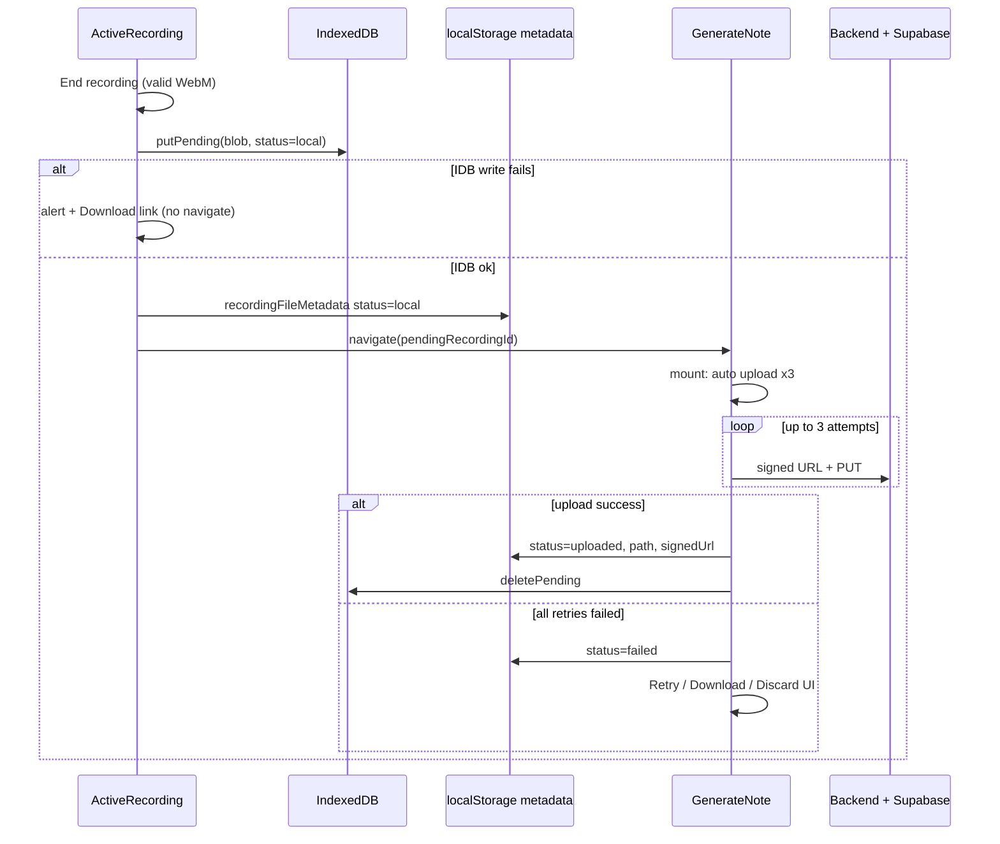

# Local recording persistence & resilient upload

Design for saving encounter recordings to **IndexedDB before navigation**, uploading from **Generate Note** with automatic retries, and guarding **Active Recording** when a local-only recording still exists.

**Primary pages:** [`src/pages/ActiveRecordingPage.jsx`](../src/pages/ActiveRecordingPage.jsx), [`src/pages/GenerateNotePage.jsx`](../src/pages/GenerateNotePage.jsx)  
**Related:** [`src/hooks/useEncounterRecording.js`](../src/hooks/useEncounterRecording.js), [`src/utils/storageConfig.js`](../src/utils/storageConfig.js), [`src/lib/api.js`](../src/lib/api.js)

**Status:** Implemented  
**Out of scope:** iOS Safari `MediaRecorder` MP4/AAC fallback; multi-recording queue; Background Sync API

---

## Problem

Today, when the user taps **End recording**:

1. `MediaRecorder` builds a `Blob` in memory.
2. The app navigates to `/generate-note` with the `File` in React Router `state`.
3. Router state is cleared immediately; only the in-flight upload closure holds the bytes.
4. `xhrUploadToSignedUrl` performs a **single** PUT with **no retries**.

If upload fails, the tab closes, or the user refreshes before upload completes, the recording is **lost**. `localStorage` only stores server path metadata after a successful upload—not the audio bytes.

---

## Goals

| Goal | Approach |
|------|----------|
| Survive refresh / tab close between stop and upload | Write blob to IndexedDB **before** `navigate` |
| Reuse existing upload UX | Generate Note page owns progress, success, and failure UI |
| Recover from transient network errors | Auto-retry upload (handoff **6×**, restore on load **1×**; manual Retry **6×**) when `status: local` |
| One pending recording at a time | Block new recording / file picker until pending is uploaded or discarded |
| Warn on Active Recording | Banner if local recording exists; hide after cloud upload + IDB delete |
| User escape hatch | **Download** `.webm` if all retries fail |
| Match existing storage rules | Align IDB cleanup with `clearAppStorage` on **different-user** sign-in |

---

## Non-goals (this PR)

- Safari/iOS `audio/mp4` recording fallback (hard-coded `audio/webm;codecs=opus` remains).
- Multiple pending recordings or a queue UI.
- Global “resume” banner on routes other than Active Recording / Generate Note (optional follow-up).
- Service worker / Background Sync.

---

## Architecture overview



**Source of truth:**

- **Bytes:** IndexedDB (`enscribe-pending-recordings` database, one object store).
- **Cheap pointer for UI restore:** `STORAGE_KEYS.newPatientEncounter.recordingFileMetadata` in `localStorage` (extended with `status` + `idbId`).

Router `state.pendingRecordingFile` (`File`) is **removed**; handoff uses `pendingRecordingId` only.

---

## IndexedDB layer

**New module:** `src/utils/pendingRecordingsDb.js`

### Database

| Property | Value |
|----------|--------|
| DB name | `enscribe-pending-recordings` |
| Version | `1` |
| Store | `pending` |
| Key | `id` (UUID string) |

### Record shape

```ts
{
  id: string;
  blob: Blob;
  mimeType: string;           // e.g. "audio/webm"
  sizeBytes: number;
  durationSec: number;
  encounterName: string;      // max 120 chars
  capturedAt: string;         // ISO-8601
  status: "local" | "uploading" | "failed";
  attempts: number;
  lastError: string | null;
  uploadedPath: string | null; // set briefly before delete on success (optional)
}
```

### API

| Function | Behavior |
|----------|----------|
| `getPending()` | Returns the single pending record, or `null`. If multiple keys exist (bug), keep newest `capturedAt`, delete others. |
| `savePending(record)` | Upsert. Enforce single-at-a-time: if another `id` exists, throw or require explicit `replace: true`. |
| `updatePending(id, partial)` | Patch `status`, `attempts`, `lastError`, etc. |
| `deletePending(id)` | Remove after successful cloud upload. |
| `pendingToFile(record)` | `new File([blob], "recording.webm", { type: mimeType })` |

### Durability helpers

- On first successful `savePending`, call `navigator.storage.persist()` (fire-and-forget).
- Wrap writes in try/catch; surface `QuotaExceededError` to caller for Download fallback.

**Size:** Typical 40 min WebM/Opus ≈ 8–20 MB; well under browser quotas (~50 MB app limit). See prior discussion in team notes.

---

## localStorage metadata (`recordingFileMetadata`)

Extend existing key: `STORAGE_KEYS.newPatientEncounter.recordingFileMetadata`.

### Status values

| `status` | Meaning | Generate Note UI |
|----------|---------|------------------|
| `local` | Blob in IDB only; not on server | Amber card: “Saved on this device”; auto-upload on load |
| `uploading` | Upload in progress | Existing progress UI (`currentStatus.progress`) |
| `failed` | 3 auto-retries exhausted | Red card: error + **Retry** / **Download** / **Discard** |
| `uploaded` | Server path available (today’s shape) | Green “Recording Ready”; **Generate Note** enabled |

### Example payloads

**After stop (before cloud):**

```json
{
  "status": "local",
  "idbId": "uuid",
  "name": "recording.webm",
  "size": 18234567,
  "duration": 412,
  "patientEncounterName": "Visit 2026-05-26 10:30"
}
```

**After successful upload (existing fields retained):**

```json
{
  "status": "uploaded",
  "path": "userId/email-timestamp-random.webm",
  "signedUrl": "https://...",
  "name": "email-timestamp-random.webm",
  "size": 18234567,
  "duration": 412
}
```

**After failed auto-retry:**

```json
{
  "status": "failed",
  "idbId": "uuid",
  "attempts": 3,
  "lastError": "Upload failed: network error",
  "name": "recording.webm",
  "size": 18234567,
  "duration": 412
}
```

`idbId` is omitted once `status === "uploaded"` and IDB row is deleted.

---

## Recording stop flow

**Files:** `useEncounterRecording.js`, `ActiveRecordingPage.jsx`

### Changes to `useEncounterRecording`

1. Accept `getEncounterName: () => string` (or `encounterName` ref) in hook options.
2. In `mediaRecorder.onstop`, after EBML validation:
   - Build `audioBlob` / `recordingFile` as today.
   - **`await savePending({ ... })`** — must complete before `onRecordingReady`.
   - On IDB failure: `alert` + trigger **Download** (`URL.createObjectURL` + programmatic `<a download>`); **do not** call `onRecordingReady` or navigate.
3. `onRecordingReady` signature becomes **`(handoff: { id, idbId, sizeBytes, durationSec, encounterName })`** — not `File`.

### Changes to `ActiveRecordingPage`

1. `navigateHandoff` passes `pendingRecordingId: id` (keep `recordingHandoffId` + `patientEncounterName` for dedup and name persist).
2. Remove `pendingRecordingFile` from router state.
3. After IDB save, write `localStorage` metadata with `status: "local"` before navigate.
4. `prepareNewRecording` continues to clear old metadata keys at **start** of a new session (unchanged), but must not run after stop—only before `getUserMedia`.

---

## Generate Note page

**File:** `GenerateNotePage.jsx`

### Extract upload pipeline

**New module:** `src/utils/uploadPendingRecording.js` (or `src/lib/uploadRecording.js`)

```ts
uploadRecordingFromPending({
  idbId,
  onProgress,        // (percent) => void
  maxAttempts: 6,
  backoffMs: [0, 2000, 6000],
}): Promise<{ path, signedUrl, metadata }>
```

**Steps (reuse existing logic):**

1. Load blob from IDB by `idbId`; if missing, set metadata `failed` + user message.
2. Set metadata `status: "uploading"`, `progress: 0`.
3. `uploadWithReactiveAuth` → signed URL → `xhrUploadToSignedUrl`.
4. On success: fetch playback signed URL, `pollForFileAccessibility` (existing).
5. Set metadata `status: "uploaded"` with `path`, `signedUrl`, `size`, `duration`.
6. **`deletePending(idbId)`**.
7. Update React state `recordingFileMetadata` to match.

**Retry policy (auto and manual Retry):**

| Error | Retry? |
|-------|--------|
| Network / XHR status 0 | Yes (up to 3) |
| HTTP 5xx on PUT | Yes |
| HTTP 4xx (auth, payload, file too large) | No — show error immediately |
| JWT / session | Use existing `fetchWithRefreshRetry`; if still 401, redirect login |

Each attempt increments `attempts` in IDB + metadata.

### Mount / handoff effects

1. **Handoff** (`location.state.pendingRecordingId`):  
   - Dedup via existing `sessionStorage` `enscribe_recording_handoff_${handoffId}`.  
   - Apply `patientEncounterName` from state.  
   - `replace: true` clear router state.  
   - Handoff: `uploadRecordingFromPending({ idbId, maxAttempts: 6 })`; restore on load: `maxAttempts: 1`.

2. **Restore on load** (after `restorationComplete`):  
   - Read `recordingFileMetadata` from `localStorage`.  
   - If `status === "local"` **or** stale `status === "uploading"` (app died mid-upload):  
     - Normalize stale `uploading` → treat as `local`.  
     - If not already uploading (guard ref + optional `navigator.locks.request('upload:' + idbId)`), run **auto upload 3×**.  
   - Guard against React Strict Mode double-invoke: `uploadInFlightRef`.

3. **`beforeunload`:** While `status === "uploading"`, set `returnValue` to warn on tab close.

### UI states (extend existing card ~line 2153)

| Status | Card style | Actions |
|--------|------------|---------|
| `local` | Amber / neutral | Shows “Saved on this device”; spinner when auto-upload running |
| `uploading` | Gray disabled (existing) | Progress % |
| `failed` | Red border | **Retry** (manual 3×), **Download recording**, **Discard** |
| `uploaded` | Green (existing) | **Generate Note** enabled |

**Generate Note** button: disabled unless `recordingFileMetadata?.status === "uploaded"` (and not `isProcessing`).

### Discard

- Single `window.confirm`: “Discard this recording? It cannot be recovered.”
- On OK: `deletePending(idbId)`, remove `recordingFileMetadata`, clear related encounter fields if appropriate.
- No typing encounter name required.

### Download

- `pendingToFile(record)` → `URL.createObjectURL` → `<a download="recording.webm">` click.
- Available on **failed** card and on IDB save failure on Active Recording (no navigate).

### Manual file upload (beta picker)

If `getPending()` returns a record with `status` in `local` | `failed` | `uploading`:

- **Block** picker; show same modal as “Start recording” (see below).

---

## Active Recording page

**File:** `ActiveRecordingPage.jsx`

### Warning banner (on mount + optional `visibilitychange`)

If pending exists (`local` | `failed` | stale `uploading`):

> You have a recording saved on this device that hasn’t been uploaded. **[Finish upload]** → `/generate-note`

- Non-blocking; does not pause recording UI.
- Hidden when no pending IDB row and metadata is `uploaded` or absent.

### Block “Start recording”

Before `startRecording()`:

- If pending exists → modal:
  - Message: unsent recording from `{capturedAt}` / encounter name.
  - **Go to Generate Note** → `navigate("/generate-note")` (page load auto-retries 3×).
  - **Discard** → confirm → `deletePending` + clear metadata → allow start.
  - **Cancel** → close modal.

Same modal for consistency when user hits blocked file upload on Generate Note (shared helper: `src/utils/pendingRecordingGuard.js` or hook `usePendingRecording()`).

---

## Stale `uploading`

If the app crashes or the tab is killed during upload:

- Next visit to `/generate-note`: metadata may still say `uploading`.
- **Treat as `local`:** reset metadata to `local`, reset IDB `status` to `local`, run fresh upload with **new signed URL** (full 3× retry).

---

## Logout & multi-user storage (verified behavior)

**Current codebase** (`src/lib/api.js`, `src/utils/storageConfig.js`):

| Event | What happens |
|-------|----------------|
| **Sign-out** (`handleSignOut`) | Deletes JWT + refresh cookie only. **Does not** call `clearAppStorage`. Encounter form data in `localStorage` **persists** on the device. |
| **Sign-in / sign-up** with **different email** than `enscribe_userEmail` | `clearAppStorage()` — removes all `enscribe_*` `localStorage` keys and app `sessionStorage` keys. |
| **`hasUserChanged` / `setCurrentUserId`** | Defined in `storageConfig.js` but **not wired** anywhere yet. User switch is effectively **email-based** on sign-in. |

**This feature must:**

1. **`clearAllPendingRecordings()`** (or `deletePending` for known id) invoked from **`clearAppStorage()`** so a different user signing in does not inherit another user’s audio blob.
2. **Not** delete IDB on routine sign-out (same user can log back in and still upload)—matches “restore storage for same user.”
3. Optional: one-line toast on sign-out if pending existed: *“You still have a recording saved on this device. Sign in again to upload it.”* (informational only; no block.)

IndexedDB is **not** cleared by today’s `getAppStorageKeys()` — explicit hook required.

---

## Files to add / modify

### New files

| File | Purpose |
|------|---------|
| `src/utils/pendingRecordingsDb.js` | IndexedDB CRUD, single-record enforcement |
| `src/utils/uploadPendingRecording.js` | Upload + retry + metadata updates + IDB delete on success |
| `src/utils/pendingRecordingGuard.js` | `hasPendingRecording()`, `showPendingRecordingModal(navigate)` |
| `docs/LOCAL_RECORDING_UPLOAD.md` | This document |

### Modified files

| File | Changes |
|------|---------|
| `src/hooks/useEncounterRecording.js` | IDB save on stop; handoff payload; encounter name option |
| `src/pages/ActiveRecordingPage.jsx` | Handoff by id; banner; start guard; IDB failure download |
| `src/pages/GenerateNotePage.jsx` | Remove `File` handoff; auto-retry on load; UI states; Discard/Download; block file picker |
| `src/utils/storageConfig.js` | Document metadata shape; call IDB clear from `clearAppStorage` |
| `src/lib/api.js` | Optional: export retry wrapper around `xhrUploadToSignedUrl` (or keep retry in upload util only) |

### Tests (manual QA checklist)

- [ ] End recording → IDB row exists → navigate → auto-upload → green ready → IDB empty.
- [ ] Refresh on Generate Note during `local` → auto-upload resumes.
- [ ] Kill tab during `uploading` → reopen Generate Note → treats as local → uploads.
- [ ] Airplane mode on load → 3 failures → failed card → Download works → Retry after network back.
- [ ] Discard → IDB empty → Active Recording banner gone → can start new recording.
- [ ] Pending exists → Start recording blocked → “Go to Generate Note” works.
- [ ] Sign in as user B after user A with pending → IDB cleared (different email).
- [ ] Sign out and sign in as same user → pending still present (if not uploaded).
- [ ] IDB write failure on stop → no navigate → Download offered.

---

## Implementation checklist (single PR)

### Phase A — Infrastructure

- [ ] `pendingRecordingsDb.js` + unit-tested helpers if test harness exists; else manual QA only.
- [ ] Extend `clearAppStorage()` to wipe IDB pending store.
- [ ] Define metadata `status` contract in comment on `storageConfig.js`.

### Phase B — Stop → IDB → navigate

- [ ] `useEncounterRecording` saves to IDB before `onRecordingReady`.
- [ ] `ActiveRecordingPage` writes `local` metadata + navigates with `pendingRecordingId`.
- [ ] IDB failure path with Download, no navigation.

### Phase C — Upload util + Generate Note

- [ ] `uploadPendingRecording.js` with 3× retry and backoff.
- [ ] Refactor `handleRecordingFileUpload` to use util for IDB-sourced files; keep file-picker path for manual uploads without pending guard conflict.
- [ ] Handoff + restore effects with in-flight guard.
- [ ] UI: `local` / `failed` cards + Download + Discard.
- [ ] `beforeunload` during upload.
- [ ] Block beta file picker when pending exists.

### Phase D — Active Recording guards

- [ ] Banner on mount when pending exists.
- [ ] `showPendingRecordingModal` on Start recording.
- [ ] Verify `prepareNewRecording` does not clear pending incorrectly.

### Phase E — Docs & cleanup

- [ ] Remove dead `pendingRecordingFile` references.
- [ ] Remove unused `STORAGE_KEYS.newPatientEncounter.recordingFile` writes if never used (already only removed, never set).

---

## Future enhancements (not in this PR)

- Banner on `/view-notes` when pending &gt; 24h old (ITP nudge on iOS Safari).
- `navigator.locks` for multi-tab upload serialization (include if trivial in PR).
- Wire `hasUserChanged(currentUserId)` on auth success for defense in depth beyond email check.
- iOS Safari `audio/mp4` MediaRecorder fallback.
- Background Sync for upload-after-offline.

---

## Related docs

- [`RECORDING_TOUCH_LOCK.md`](./RECORDING_TOUCH_LOCK.md) — pocket mode / active recording UX
- [`PROMPT_LLM_FRONTEND_MIGRATION.md`](./PROMPT_LLM_FRONTEND_MIGRATION.md) — job flow after upload
